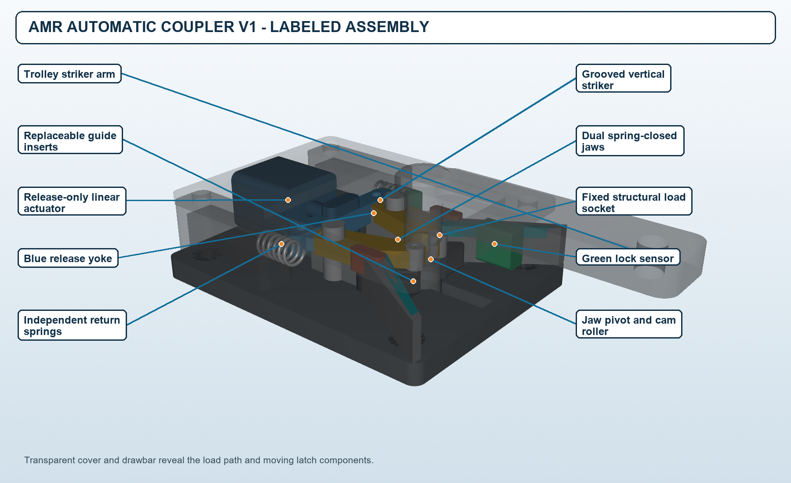
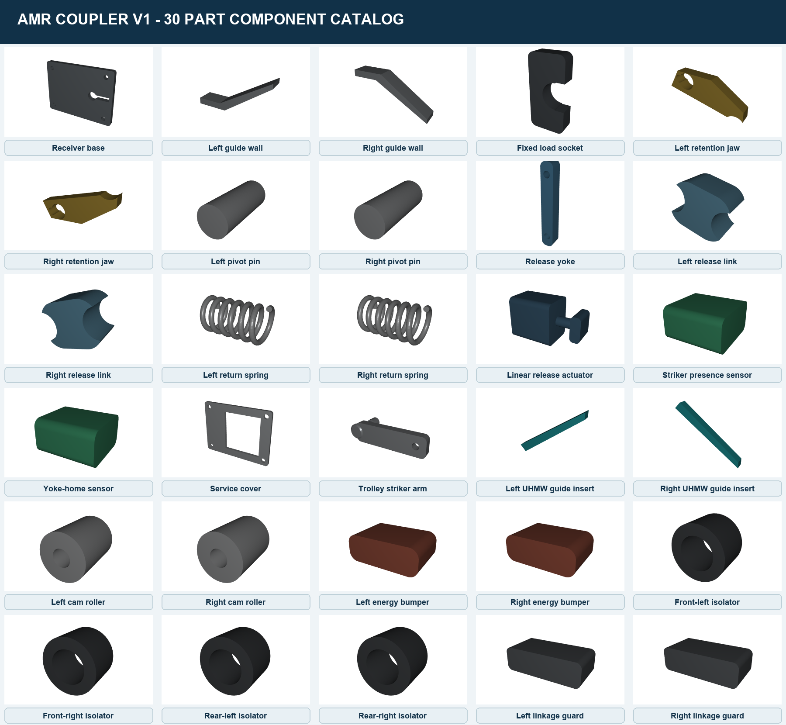
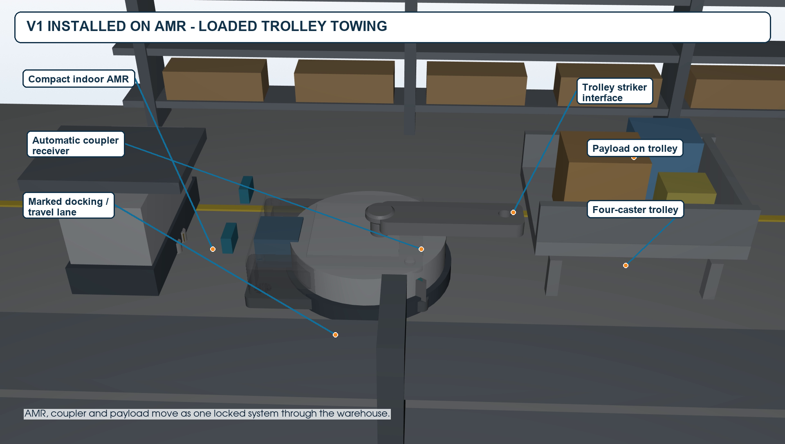

# AMR automatic coupler V1

Parametric CAD for a compact AMR-to-trolley automatic coupling. V1 uses a fixed structural load socket, dual spring-closed helmet-style retention jaws, a release-only linear actuator, independent pin/release sensing, replaceable wear inserts, rolling cam followers and payload profiles.

## Build

```powershell
python -m pip install cadquery==2.6.1 vtk==9.3.1 imageio imageio-ffmpeg
python .\src\build_amr_coupler_v1.py
python .\src\render_v1_professional_demo.py
python .\src\render_v1_moving_360.py
python .\src\create_v1_labeled_photos.py
python .\src\validate_v1.py
```

Outputs are written under `outputs/v1/`, including coupled and released STEP/STL assemblies, 30 individual part STLs, a 360-degree MP4, and a working AMR/payload coupling and decoupling MP4.

`AMR_Coupler_V1_Specification.pdf` is the rendered three-page specification sheet covering the mechanical interface, operating sequence, payload profiles, materials, maintenance and qualification requirements.

`clearance_audit_v1.json` records the repeatable coupled/released interference check. The audited functional pairs have zero unintended solid overlap; intended pivot, clevis and fastener contacts are explicitly excluded and must be detailed during production engineering.

The professional operation video shows a warehouse approach, then a cutaway with the actual striker, jaws, moving links, yoke, actuator rod and lock sensor. It zooms out to the AMR towing a loaded trolley and finishes with parking, powered release and physical separation. The moving 360-degree video rotates around the mechanism during a complete release-and-recapture cycle. These are kinematic engineering demonstrations; final spring rates, actuator stroke/force and control timing must be established by test.

## Videos

GitHub may not show an inline preview because the MP4 files are approximately 8-10 MB. Use these direct links to open or download them:

- [Working AMR coupling and decoupling demonstration](outputs/v1/amr_coupler_v1_amr_operation.mp4)
- [Moving 360-degree coupling, release and recapture demonstration](outputs/v1/amr_coupler_v1_360.mp4)

## Labeled images

### Coupler assembly and major components



### Complete 30-part catalog



### Coupler installed on the AMR and loaded trolley



## Safety

Concept prototype only. The included load calculations are screening estimates, not certification. Complete FEA, tolerance analysis, spring sizing, actuator sizing, guarding, safety-rated controls, fatigue/impact evaluation and physical proof testing before real towing. See `docs/PATENT_DESIGN_AROUND_REVIEW.md` for the preliminary patent-risk screen.
